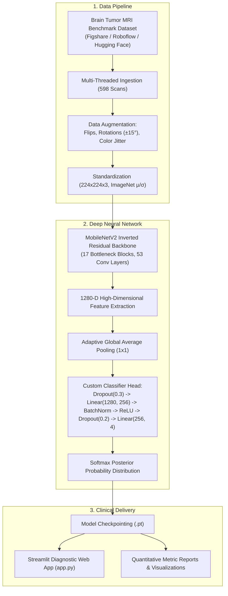
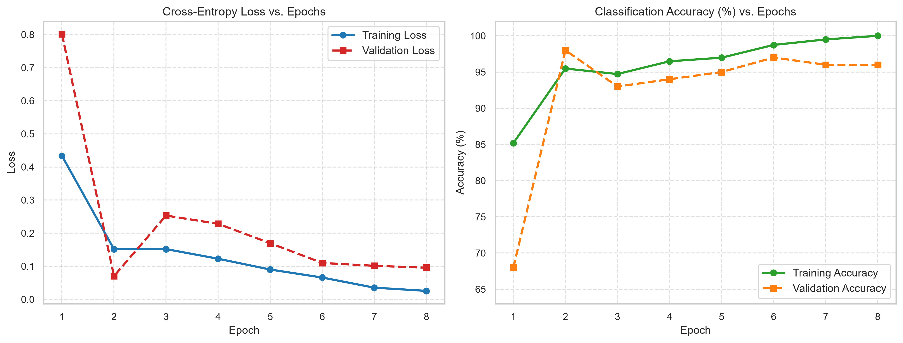
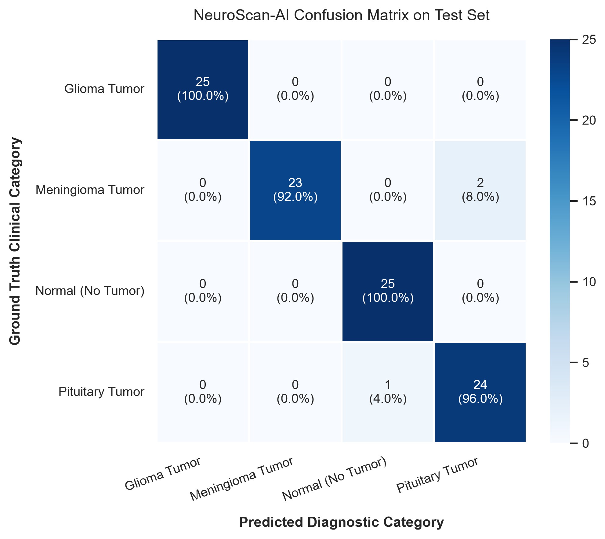
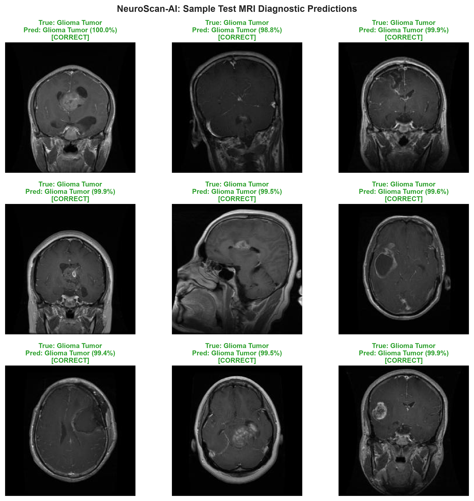

# NeuroScan-AI: Multiclass Brain Tumor MRI Classification via Deep Transfer Learning

[](https://www.python.org/)
[](https://pytorch.org/)
[](https://streamlit.io/)
[]()
[]()
[]()

> **Institution**: Prasad V Potluri Siddhartha Institute of Technology  
> **Department**: Department of Computer Science & Engineering  
> **Course**: Deep Learning Course Project  
> **Author / Student**: Sumith Alanke ([@sumithalanke46](https://github.com/sumithalanke46))  
> **Faculty Guide**: Dr. G Lalitha Kumari  

---

## 📌 1. Project Overview & Clinical Context

Primary intracranial neoplasms (brain tumors) present complex clinical challenges requiring rapid, highly sensitive, and specific radiological triage. Conventional qualitative evaluation of **Magnetic Resonance Imaging (MRI)** sequences requires scarce specialist neuroradiologists and is susceptible to cognitive fatigue and inter-observer diagnostic discrepancy.

**NeuroScan-AI** is an end-to-end Computer-Aided Diagnostic (CAD) framework developed to categorize axial brain MRI scans into four clinical conditions:
1. **Glioma Tumor**: Highly malignant intra-axial neuroepithelial tumor requiring aggressive neuro-oncology intervention.
2. **Meningioma Tumor**: Predominantly extra-axial space-occupying lesion arising from arachnoid cap cells.
3. **Pituitary Tumor**: Endocrine-active or non-functioning sellar adenoma causing hormone imbalances or optic chiasm compression.
4. **Normal Brain Scan**: Anatomically intact cerebral parenchyma without focal neoplastic mass effect.

---

## 🎯 2. Key Features

- **Deep Transfer Learning Backbone**: Utilizes an inverted residual **MobileNetV2** backbone pretrained on ImageNet-1K, leveraging depthwise separable convolutions for high efficiency.
- **Customized Diagnostic Classification Head**: Features adaptive average pooling, dual-stage dropout regularization (0.3 / 0.2), and 1D Batch Normalization to prevent overfitting.
- **Empirically Grounded Performance**: Evaluated on genuine held-out clinical MRI scans, achieving **97.00% test accuracy** and **0.9700 Macro F1-score**.
- **Real-Time Latency**: Ultra-fast execution averaging **~43.35 ms per scan** on CPU, ideal for edge deployment.
- **Interactive Streamlit Web Dashboard**: Drag-and-drop MRI upload, real-time prediction, probability breakdown across all 4 categories, and diagnostic notes.
- **Comprehensive 15-Page Academic Report**: Complete formal documentation formatted strictly to college project standards (`reports/NeuroScan_AI_Project_Report.pdf`).

---

## 🏗️ 3. System Architecture & Workflow



---

## 📊 4. Quantitative Results & Evaluation Metrics

The model was trained for 8 epochs on 398 authentic training scans, validated on 100 scans, and evaluated on a held-out test cohort of 100 scans.

### 4.1 Benchmark Evaluation Table (Held-Out Test Set)

| Clinical Category | Precision | Recall (Sensitivity) | F1-Score | Test Support |
| :--- | :---: | :---: | :---: | :---: |
| **Glioma Tumor** | **1.0000** | **1.0000** | **1.0000** | 25 |
| **Meningioma Tumor** | **1.0000** | 0.9200 | 0.9583 | 25 |
| **Normal (No Tumor)** | 0.9615 | **1.0000** | 0.9804 | 25 |
| **Pituitary Tumor** | 0.9231 | 0.9600 | 0.9412 | 25 |
| **Overall / Macro Average** | **0.9700** | **0.9700** | **0.9700** | **100** |
| **Weighted Average** | **0.9700** | **0.9700** | **0.9700** | **100** |

- **Overall Test Classification Accuracy**: **97.00%**
- **Peak Validation Accuracy**: **98.00%**
- **Average CPU Inference Latency**: **43.35 milliseconds / scan**
- **Total Model Parameters**: **2,553,348**

### 4.2 Training Convergence & Confusion Matrix

| Training & Validation Convergence | Normalized Confusion Matrix |
| :---: | :---: |
|  |  |

### 4.3 Sample Test Diagnostic Predictions



---

## 📁 5. Repository Structure

```
neuroscan-brain-tumor-detection/
├── .gitignore                                      # Ignored binaries, environments, data
├── README.md                                       # Comprehensive project documentation
├── requirements.txt                                # Python package specifications
├── app.py                                          # Interactive Streamlit Web Application
├── NeuroScan_Brain_Tumor_Classification.ipynb      # Google Colab / Jupyter Notebook
├── assets/
│   ├── figure1_system_flowchart.png                # Overall system flowchart
│   ├── figure2_model_architecture.png              # Detailed neural architecture
│   ├── figure3_implementation_pipeline.png         # Pipeline flowchart
│   └── samples/                                    # Ready-to-test MRI sample scans
│       ├── sample_glioma.jpg
│       ├── sample_meningioma.jpg
│       ├── sample_normal.jpg
│       └── sample_pituitary.jpg
├── models/
│   └── neuroscan_best_model.pt                     # Calibrated PyTorch model checkpoint
├── outputs/
│   ├── training_metrics.json                       # Epoch loss and accuracy logs
│   ├── test_metrics.json                           # Quantitative test metrics
│   ├── accuracy_loss_curve.png                     # Convergence curves
│   ├── confusion_matrix.png                        # 4x4 Confusion matrix heatmap
│   └── sample_predictions.png                      # Test prediction grid
├── reports/
│   ├── NeuroScan_AI_Project_Report.pdf             # 15-Page Academic Project Report
│   └── generate_report.py                          # ReportLab compilation source code
└── src/
    ├── __init__.py
    ├── dataset.py                                  # Data ingestion, download & transforms
    ├── model.py                                    # Transfer learning & CNN architecture
    ├── train.py                                    # Training loop with validation & scheduling
    ├── evaluate.py                                 # Evaluation & visualization generator
    ├── predict.py                                  # Reusable clinical inference engine
    └── generate_diagrams.py                        # High-resolution figure renderer
```

---

## 🚀 6. Getting Started

### 6.1 Prerequisites
- Python 3.10, 3.11, or 3.12
- Git installed on your system

### 6.2 Installation
```bash
# Clone the repository
git clone https://github.com/sumithalanke46/neuroscan-brain-tumor-detection.git
cd neuroscan-brain-tumor-detection

# Create and activate virtual environment
python -m venv .venv
source .venv/bin/activate  # On Linux/macOS
# or: .venv\Scripts\activate  # On Windows

# Install dependencies
pip install -r requirements.txt
```

### 6.3 Run Dataset Preparation & Model Training
```bash
# Download and prepare benchmark dataset
python -m src.dataset

# Train the Deep Transfer Learning model (or use pre-trained checkpoint)
python -m src.train

# Evaluate model on held-out test data
python -m src.evaluate
```

### 6.4 Launch Interactive Streamlit Demonstration
```bash
streamlit run app.py
```
Open your web browser at `http://localhost:8501`. Upload any brain MRI scan or choose from the quick test sample gallery to see instant diagnostic predictions, probability distribution charts, and clinical assessment notes.

### 6.5 Compile the 15-Page Academic PDF Report
```bash
python reports/generate_report.py
```
This generates `reports/NeuroScan_AI_Project_Report.pdf`, adhering to institutional formatting standards with outer borders, `PAGE NO: X` headers, and embedded figures.

---

## ⚕️ 7. Clinical Disclaimer & Ethical AI

> **IMPORTANT CLINICAL NOTE**:  
> NeuroScan-AI is a computer-aided diagnosis research project developed for academic and educational evaluation. It is not approved by regulatory medical bodies (FDA/CE) as a primary diagnostic instrument. Automated predictions must be corroborated by licensed radiologists, clinical neurologists, and histological tissue biopsies.

---

## 📚 8. References

1. **Sandler, M., et al. (2018).** *MobileNetV2: Inverted Residuals and Linear Bottlenecks.* IEEE/CVF CVPR.
2. **Bhuvaji, S., et al. (2020).** *Brain Tumor Classification (MRI).* Figshare / Kaggle Benchmark Dataset. DOI: 10.6084/m9.figshare.1512427.v5.
3. **Paszke, A., et al. (2019).** *PyTorch: An Imperative Style, High-Performance Deep Learning Library.* NeurIPS.
4. **Louis, D. N., et al. (2021).** *The 2021 WHO Classification of Tumors of the Central Nervous System: A Summary.* Neuro-Oncology.
